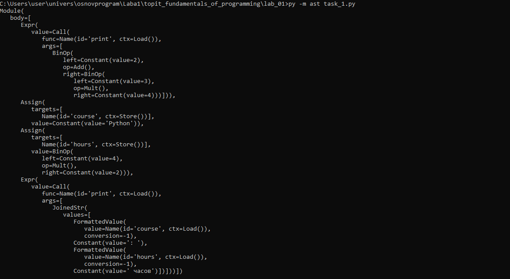
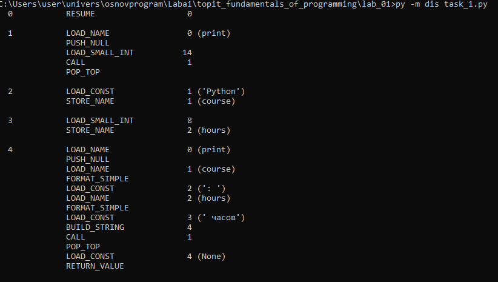
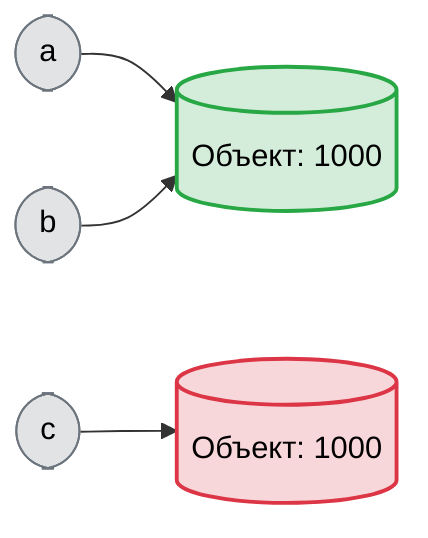

# Задание 1
1. Это связано с особенностями работы REPL. Функция print() заложена в архитектуру REPL, а в файле по умолчанию нет никакой функции, так что после выполнения файла он ничего не выводит.
2. Выржениями являются строки:
    4 * 2
    print(f"{course}: {hours} часов")
Инструкциями являются строки:
    course = "Python" и hours = 4 * 2 (присваивание)
    print(f"{course}: {hours} часов") (вызов функции)
Литералы:
    Строковые
    Целочисленные
Какие имена создаются:
    course
    hours
3. 

4. Байткод CPython — это промежуточное представление программы, которое не может напрямую выполняться процессором компьютера, так как предназначено для виртуальной машины
# Задание 2
1. 

2. Основное отличие в том, что равенство значений отвечает говорит, что значние объектов одинаково, а равенство объектов показывает ли один ли это объект или нет
4. При выполнении программы, оба print выводят True, так как компилятор склеивает выражение, состоящие из текстовых литералов.
5. Применяем ==, когда нам важно, чтобы данные совпадали. Интерпретатор проверит содержимое объектов даже если они занимают разные участки памяти. Применяем is, когда требуется доказать, что переменная указывает на конкретный уникальный объект.
6. Вопросы:
    1)Нет, инструкция `b = a` заставляет ссылаться объект а на одну ячейку памяти с a
    2)type() возвращает тип объекта, id() возвращает уникальный индификатор объекта
    3)Так как для чисел и строк важнее значение, а не место в памяти. None же всегда имеет уникальнею и единственную ячейку памяти, обращятса к которой по id проще и быстрее.

# Задание 3

1. / и // выполняют разные операции, 1-я выполняет обычное диление, которое может быть с остатком, а может нет, из-за чего тип данных всегда float. 2-я же это целая часть от диления, от чего будет тип данных int.

2. Основное отличие заключается в том, что целочисленный тип данных  в Python не имеет придела значения, в отличии от остальных языков.

3. Наблюдаемое происходит из-за накапливаемой погрешности, так как числа 0.1 и 0.2 нельзя представить в двоичном коде, кроме как бесконечной дробью,а так как тип данных float ограничен, то дробь обрезается. Для проверки равенства чисел с плавающей точкой надо использовать функцию math.isclose()

4. Так как при переводе программа не смотрит на содержание строки. Если строка не пустая имеется, то значение будет True, если строка пустая, то False

5. Вопросы:
    1)Так как деление не всегда выдает результат в виде целого числа.
    2)int("42") — это парсинг (разбор) строки. Python читает символы текста и преобразует их в число. А int(42.9) просто отсекает дробную часть выводя просто 42 
    3)bool(0) и bool("")

# Задание 4

8. TypeError: 'str' object does not support item assignment

9. Вопросы:
    1)len(symbol) считает количество символов в строке. len(symbol.encode("utf-8")) считает количество байтов, которые занимает эта строка в памяти при кодировании в UTF-8.
    2)start (включительно): Индекс, с которого начинается извлечение. stop (исключительно): Индекс, на котором извлечение останавливается. step (шаг): Интервал, с которым выбираются символы. Если указать отрицательное число, то срез пойдет в обратном порядке.
    3)Неизменяемость означает, что после создания объекта строки его содержимое в оперативной памяти невозможно изменить. Когда вызывается метод .upper() или .replace() или прибавляете к строке другую строку, Python не меняет исходный объект. Вместо этого он создает в памяти совершенно новую строку с нужными изменениями и возвращает её.

# Задание 5

1. 
researcher_name	str
experiment_name	str
runs_count	int
run_duration	float
coeff_real	float
coeff_imag	float
total_seconds	float
total_minutes	float
complex_coeff	complex
coeff_modulus_sq	float
has_runs	bool

2.
total_seconds: имя переменной, с которым связывается итоговый результат типа float.
=: оператор присваивания.
runs_count: переменная типа int.
*: оператор бинарного умножения.
run_duration: переменная типа float.

3.

1) Исходный код (.py): Скрипт считывается с диска как текстовый файл.
2) Лексический и синтаксический анализ: Текст программы разбивается на токены и строится абстрактное синтаксическое дерево (AST).
3) Компиляция в байткод: AST компилируется в байткод — набор инструкций для виртуальной машины Python.
4) Выполнение виртуальной машиной: CPython VM пошагово исполняет инструкции байткода, взаимодействуя с оперативной памятью.

4.
Результат функции input() всегда имеет тип str. Если попытаться выполнять математические операции со строками, возникнет ошибка TypeError или произойдет конкатенация строк. Поэтому данные явно преобразуются с помощью int() и float().

5. Вопросы:
    Имя переменной отвязывается от старого объекта в памяти и связывается с новым объектом. Старый объект, если на него больше нет других ссылок, становится кандидатом для автоматического удаления сборщиком мусора.
