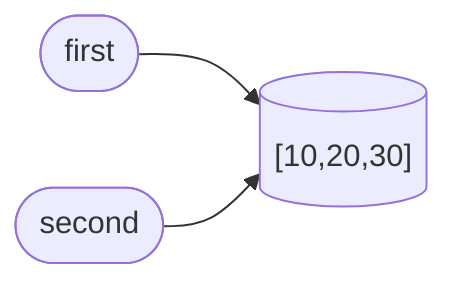
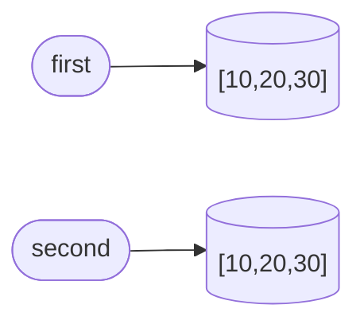
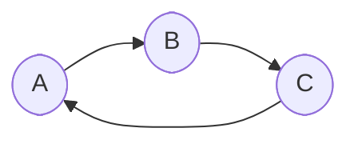

# Задание 1

1. Это происходит, так как += интерпретируется как значение в товой ячейке памяти равно значению старой ячейки +1, а b ссылается на старую ячейку.

2.
До:

После:

3. Вопросы:
    1)Нет не меняет, так мы просто показываем, что объект secjnd будет ссылаться на одину и ту же ячейку памяти, что и first.
    2)Это происходит из-за того, что значение неизменяемых объектов закреплено в опр ячейке памяти, и при изменении создается новая ячейка  с другим не измен объектом
    3)Использовать функцию id()

# Задание 2

1.
| Операция | Новый внешний объект | Новые вложенные объекты | Изменения независимы |
|---|---|---|---|
| Присваивание | Нет (указывает на тот же объект) | Нет (указывает на тот же объект) | Нет |
| Поверхностная копия | Да | Нет (указывает на тот же объект) | Частично |
| Глубокая копия | Да | Да | Да |

2. оператор умножения * 3 не дублирует вложенный список, а создаёт три ссылки на один и тот же объект в памяти. Генератор списка вычисляет выражение [0] * 3 трижды в ходе трёх отдельных итераций цикла. В результате в памяти создаются три независимых списка.

3. Вопросы:
    1)Внешнее копирование создает новый объект на верхнем уровне. Но если внутри этого объекта есть вложенные изменяемые структуры (например, список внутри списка или словарь внутри словаря), то вложенные объекты не копируются — копируются только ссылки на них. Глубокая копия копирует сам объект и абсолютно все вложенные в него структуры на всех уровнях.
    2)Глубокое копирование занимает больше времени и памяти.
    3)Поверхностная копия еспользуется, если структура данных содержит только неизменяемые объекты, так как изменение неизменяемого объекта всегда приводит к созданию нового в памяти. Также она применима, когда требуется изолировать добавление или удаление элементов на верхнем уровне контейнера, сохраняя при этом общие вложенные компоненты.

# Задание 3

1.1 Функция sys.getrefcount(obj) принимает объект в качестве аргумента. В момент вызова функции интерпретатор Python временно создаёт ещё одну ссылку на этот объект для передачи его в функцию. Эта временная ссылка существует только во время выполнения вызова и исчезает сразу после его завершения, из-за чего возвращаемое значение всегда на единицу больше реального числа постоянных ссылок в коде.
1.2
Создание имени (присваивание)
Помещение в контейнер
Передача в функции и методы
1.3 Удаление имени через del: Инструкция del alias удаляет связь между именем и объектом в пространстве имён, уменьшая счётчик ссылок на 1.
Очистка или удаление элементов контейнера: Вызовы методов вроде container.clear() или удаление элементов из структуры данных убирают ссылки, которые хранились внутри контейнера.
Выход объекта из области видимости: Когда блок кода (функция или цикл), в котором было объявлено имя, завершает работу, все локальные имена удаляются, уменьшая счётчики связанных с ними объектов.
2. Обычное связывание имени с объектом создаёт сильную ссылку, которая увеличивает счётчик ссылок объекта . Сборщик мусора Python удаляет объект только тогда, когда этот счётчик падает до нуля. Слабая ссылка , напротив, ссылается на объект в памяти, не увеличивая его счётчик ссылок. Поэтому она не мешает Python уничтожить объект, если все сильные ссылки на него исчезли. Слабые ссылки часто применяются в кэшировании. Если приложение хранит большой объект в кэше, использование обычных ссылок приведёт к утечке памяти — кэш будет бесконечно удерживать объекты.
3. Вопросы:
    1)Объект освобождается тогда и только тогда, когда счётчик ссылок на него падает до нуля, что означает отсутствие каких-либо активных имён, элементов контейнеров или атрибутов, указывающих на этот объект.
    2)Нет, не всегда. Python использует собственный менеджер памяти, который кэширует освобождённые блоки памяти для ускорения создания будущих объектов.
    3)Сильная ссылка увеличивает счётчик ссылок объекта и гарантирует, что объект останется в памяти, пока эта ссылка существует. Слабая ссылка указывает на объект, не увеличивая его счётчик ссылок

# Задание 4

1.1 Обычный механизм подсчета ссылок основан на том, что счетчик ссылок каждого объекта отражает количество прямых указателей на него. Когда создаётся взаимная ссылка, каждый из списков имеет счётчик ссылок, равный как минимум 1.
Когда инструкции del first и del second удаляют внешние имена, счётчики ссылок уменьшаются на единицу, но не падают до нуля — они остаются равными 1 из-за закольцованной ссылки друг на друга.
1.2 Поколения сборщика мусора служат для оптимизации производительности процесса очистки памяти. Идея заключается в том, что большинство создаваемых в программе объектов живут очень недолго, в то время как объекты, пережившие несколько циклов сборки, скорее всего, останутся нужны до конца работы программы.

2. 

3. Вопросы:
    1)Циклическая ссылка возникает, когда два или более контейнерных объекта содержат прямые или косвенные ссылки друг на друга, образуя замкнутый контур.
    2)Объект может входить в состав изолированного циклического кольца. Даже после удаления всех внешних имён счётчики ссылок элементов этого кольца остаются равными как минимум единице из-за внутренних перекрёстных указателей.
    3)Это разделение основано на том, что большинство объектов в программах живут очень недолго. Поколения позволяют проверять младшие объекты гораздо чаще, не тратя процессорное время на сканирование долгоживущих структур данных, которые уже прошли проверку и редко удаляются.

# Задание 5

1. В Python списки, кортежи и другие составные контейнеры хранят не сами объекты, а ссылки на них в памяти. Функция sys.getsizeof() возвращает размер памяти, занимаемый исключительно самим контейнером

2. 
1)Нет. Размер меняется скачкообразно (только при достижении зарезервированного лимита).
2)Это оптимизация для ускорения добавления элементов. Если бы под каждый новый элемент память выделялась заново, операция append() работала бы за $O(N)$ из-за постоянного копирования данных.
3)Длина — это количество фактически хранящихся в данный момент элементов. Объем выделенной памяти отражает общую емкость внутреннего массива вместе с зарезервированным «пустым» пространством для будущих добавлений.

3. Последовательность (list) физически создаёт в памяти 100 000 отдельных объектов или указателей, что требует значительного объёма оперативной памяти. Объект range использует ленивые вычисления.Он хранит только три числовых параметра (старт, стоп и шаг) и вычисляет каждое следующее значение на лету по мере необходимости, потребляя минимальный и неизменный объём памяти независимо от размера диапазона.

4. Итог:
1) Использование ленивых итераторов и генераторов вместо материализованных коллекций
(`tracemalloc` и сравнение `range` с `list`).
Создание полных списков элементов в оперативной памяти приводит к резкому скачку потребления ресурсов (пиковая нагрузка). Применение генераторов, итераторов и встроенных классов вроде `range` позволяет обрабатывать потоки данных последовательно, сохраняя в памяти только текущее состояние вычислений.

2) Применение неизменяемых структур данных (кортежей) для фиксированных наборов
(измерение размеров контейнеров через `sys.getsizeof()`) и эксперименты с изменяемостью.
Кортежи (`tuple`) занимают меньше памяти по сравнению со списками аналогичной длины, поскольку Python не выделяет для них дополнительный буфер «на вырост» под динамическое добавление элементов. Если коллекция данных после создания не должна изменяться, использование кортежей снижает накладные расходы памяти.

3) Предотвращение утечек памяти с помощью слабых ссылок (`weakref`)
Эксперименты со слабыми ссылками и `WeakValueDictionary`.
При построении кэшей, реестров или сложных графовых структур сильные ссылки удерживают объекты в памяти даже тогда, когда основная бизнес-логика в них больше не нуждается. Использование механизмов `weakref` позволяет автоматически освобождать память, как только объекты теряют основные сильные ссылки, предотвращая накопление «мусора».

5. 