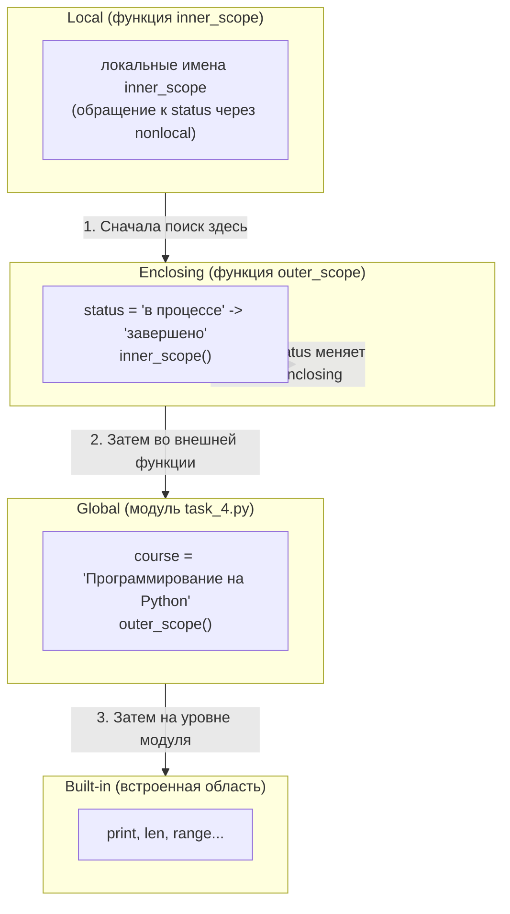

# Задание 1.

### Таблица тестовых сценариев

| № | Балл (`score`) | Тип работы (`work_type`) | Пропуски (`absences`) | Ожидаемый результат | Фактический результат | 
| ----- | ----- | ----- | ----- | ----- | ----- | 
| 1 | `0` | `exam` | `0` | недостаточный (экзаменационная) | Балл: 0, Тип: экзаменационная работа, Пропуски: 0 -> Уровень: недостаточный | 
| 2 | `59` | `practice` | `2` | недостаточный (практическая) | Балл: 59, Тип: практическая работа, Пропуски: 2 -> Уровень: недостаточный | 
| 3 | `60` | `project` | `1` | удовлетворительный (проектная) | Балл: 60, Тип: проектная работа, Пропуски: 1 -> Уровень: удовлетворительный | 
| 4 | `74` | `exam` | `4` | недостаточный (снижен с удовл.) | Балл: 74, Тип: экзаменационная работа, Пропуски: 4 -> Уровень: недостаточный | 
| 5 | `75` | `practice` | `0` | хороший (практическая) | Балл: 75, Тип: практическая работа, Пропуски: 0 -> Уровень: хороший | 
| 6 | `89` | `project` | `5` | удовлетворительный (снижен с хор.) | Балл: 89, Тип: проектная работа, Пропуски: 5 -> Уровень: удовлетворительный | 
| 7 | `90` | `exam` | `3` | отличный (экзаменационная) | Балл: 90, Тип: экзаменационная работа, Пропуски: 3 -> Уровень: отличный | 
| 8 | `100` | `practice` | `4` | хороший (снижен с отл.) | Балл: 100, Тип: практическая работа, Пропуски: 4 -> Уровень: хороший | 
| 9 | `105` | `exam` | `1` | Ошибка валидации | Ошибка: некорректные входные данные | 
| 10 | `80` | `seminar` | `-1` | Ошибка валидации | Ошибка: некорректные входные данные | 

### Порядок проверки условий и недостижимые ветви

1. **Валидация границ:** В самом начале проверяется попадание параметров в допустимые интервалы (`0 <= score <= 100` и `0 <= absences <= 5`). Это позволяет сразу отсечь некорректные данные (ранний выход) и гарантировать, что дальнейшая логика работает только с валидными значениями.

2. **Порядок ветвления:** Проверка уровня баллов организована строго по убыванию: сначала `score >= 90`, затем `score >= 75`, затем `score >= 60` и ветвь `else` для остальных значений (`0–59`).

3. **Недостижимые ветви:** Если нарушить порядок и поставить менее строгое условие раньше более строгого (например, написать `if score >= 60:` перед `elif score >= 90:`), то ветви `>= 75` и `>= 90` станут **недостижимыми** (мертвым кодом), так как любое число больше 75 или 90 автоматически удовлетворяет условию `>= 60`.

## Задание 2.

### Оценка сложности алгоритмов

| Алгоритм | Временная сложность | Дополнительная память | Параметр роста $n$ | 
| ----- | ----- | ----- | ----- | 
| Однопроходная статистика | $O(n)$ | $O(1)$ | Количество элементов в списке `measurements` | 
| Подсчет элементов выше среднего | $O(n)$ | $O(1)$ | Количество элементов в списке `measurements` | 
| Линейный поиск | $O(n)$ | $O(1)$ | Длина списка `arr` | 
| Проверка простоты числа | $O(\sqrt{n})$ | $O(1)$ | Величина проверяемого числа $n$ | 
| Сортировка выбором | $O(n^2)$ | $O(n)$ | Длина сортируемого списка (память $O(n)$ на копию) | 
| Бинарный поиск | $O(\log n)$ | $O(1)$ | Длина отсортированного списка | 

### Обоснование ограничения делителей при проверке простоты

Если целое число $n > 1$ является составным, его можно представить в виде произведения двух натуральных множителей: $n = a \cdot b$, где $a > 1$ и $b > 1$. Если бы оба множителя одновременно были строго больше $\sqrt{n}$, то их произведение составило бы $a \cdot b > \sqrt{n} \cdot \sqrt{n} = n$, что приводит к противоречию. Следовательно, хотя бы один делитель составного числа гарантированно не превышает $\sqrt{n}$, и проверять числа дальше этого порога не имеет смысла.

### Сравнение числа операций (линейный и бинарный поиск)

| Размер массива ($n$) | Линейный поиск (сравнений) | Бинарный поиск (сравнений) | 
| ----- | ----- | ----- | 
| 10 | 10 | 8 | 
| 100 | 100 | 14 | 
| 1000 | 1000 | 20 | 

## Задание 3.

### Обоснование выбора структур данных

1. **Множество (`set`) для уникальных значений:** Множество построено на основе хеш-таблицы. При попытке добавить дубликат вычисляется его хеш, и элемент игнорируется, если он уже присутствует в таблице. Это гарантирует уникальность без ручных проверок и обеспечивает быструю проверку вхождения (`in`).

2. **Кортеж (`tuple`) как ключ словаря:** Ключ словаря в Python обязан быть хешируемым (*hashable*), то есть его хеш-значение не должно меняться на протяжении всего времени жизни объекта. Кортеж из строк `(student, laboratory)` является неизменяемым (*immutable*), поэтому он корректно вычисляет хеш и подходит для составного ключа.

3. **Список (`list`) нельзя использовать как ключ:** Список — изменяемая коллекция. Если бы его можно было поместить в словарь в качестве ключа, последующее изменение списка (например, `append()`) изменило бы его содержимое, и словарь не смог бы найти запись по старому хешу. Поэтому в Python у типа `list` метод `__hash__` намеренно отключен (`TypeError: unhashable type: 'list'`).

4. **Словарь (`dict`) вместо списка для поиска по ключу:** Поиск элемента в списке по составному условию требует полного перебора элементов за линейное время $O(n)$, тогда как словарь находит значение по хешу ключа напрямую за константное время $O(1)$.

### Сложность операций использованных коллекций

| Коллекция | Операция | Средняя сложность | Худшая сложность | 
| ----- | ----- | ----- | ----- | 
| `set` (множество) | Добавление (`add`) | $O(1)$ | $O(n)$ | 
| `set` (множество) | Проверка вхождения (`in`) | $O(1)$ | $O(n)$ | 
| `dict` (словарь) | Поиск по ключу (`d[key]`) | $O(1)$ | $O(n)$ | 
| `dict` (словарь) | Вставка / обновление (`d[key] = val`) | $O(1)$ | $O(n)$ | 
| `list` (список) | Добавление в конец (`append`) | $O(1)$ | $O(n)$ | 

## Задание 4.

### Схема областей видимости (правило LEGB)

**Порядок поиска имен при вызове `print("Внутри inner:", course, "|", status)` внутри `inner_scope()`:**

1. **`status`**: отсутствует в Local (`inner_scope`) $\rightarrow$ найдено в Enclosing (`outer_scope`). Благодаря ключевому слову `nonlocal` присваивание внутри `inner_scope` изменяет именно переменную из `outer_scope`, не создавая новую локальную копию.

2. **`course`**: отсутствует в Local $\rightarrow$ отсутствует в Enclosing $\rightarrow$ найдено в Global (уровень модуля).

3. **`print`**: отсутствует в Local, Enclosing и Global $\rightarrow$ найдено в Built-in (встроенные функции Python).

### Жизненный цикл изменяемого значения по умолчанию

В исходной функции `def add_result(value, results=[]):` пустой список `[]` создается **один единственный раз** в момент выполнения инструкции `def` (при компиляции/загрузке функции в память) и сохраняется в атрибуте `add_result.__defaults__`. При каждом последующем вызове функции без передачи второго аргумента Python не создает новый список, а передает ссылку на один и тот же объект из `__defaults__`. В результате данные от предыдущих вызовов накапливаются в этом списке.

**Исправление:** использование неизменяемого маркерного значения `None` по умолчанию (`results=None`) с созданием нового списка внутри тела функции при каждом вызове.

### Замыкания (`make_threshold_checker`)

При вызове `pass_exam = make_threshold_checker(60)` возвращается внутренняя функция `check`, которая запоминает ссылку на переменную `threshold = 60` из объемлющей области видимости (в атрибуте `__closure__`). Второй вызов `make_threshold_checker(90)` создает **новый** кадр стека и новое замыкание со значением `90`. Поэтому обе функции работают независимо друг от друга.

## Задание 5.

### Контракты публичных функций

1. **`mean(values: list[int | float]) -> float`**

   * *Входные данные:* список чисел (`int` или `float`).

   * *Результат:* среднее арифметическое элементов в виде `float`.

   * *Особые случаи:* если передан пустой список `[]`, возвращает `0.0` без выброса `ZeroDivisionError`.

2. **`minimum(values: list[int | float]) -> int | float | None` и `maximum(values: list[int | float]) -> int | float | None`**

   * *Входные данные:* список чисел (`int` или `float`).

   * *Результат:* наименьший / наибольший элемент списка.

   * *Особые случаи:* для пустого списка возвращают `None`.

3. **`classify(score: float) -> str`**

   * *Входные данные:* числовой средний балл.

   * *Результат:* строка с текстовой категорией (`"отличный"`, `"хороший"`, `"удовлетворительный"`, `"недостаточный"`).

   * *Особые случаи:* граничные значения (`90`, `75`, `60`) относятся к более высокой категории.

4. **`student_summary(name: str, results: list[int]) -> dict`**

   * *Входные данные:* строка с именем студента и список его оценок.

   * *Результат:* словарь со сводкой (`name`, `mean`, `min`, `max`, `category`, `has_results`).

   * *Особые случаи:* если у студента нет оценок (`results == []`), проставляется флаг `has_results: False`, категория `"нет оценок"`, а вместо экстремумов — `None`.

5. **`find_top_students(students: dict[str, list[int]]) -> list[str]`**

   * *Входные данные:* словарь формата `{имя_студента: список_оценок}`.

   * *Результат:* список имен студентов с максимальным средним баллом.

   * *Особые случаи:* если лидеров несколько (одинаковый средний балл), возвращаются все; студенты без оценок игнорируются; для пустой группы возвращается `[]`.

6. **`group_summary(students: dict[str, list[int]]) -> dict`**

   * *Входные данные:* словарь с данными всей группы.

   * *Результат:* словарь с общим средним баллом группы (`group_mean`), распределением по категориям (`categories`), списком лидеров (`top_students`) и отсортированным по убыванию среднего балла рейтингом имен (`ranking`).

   * *Особые случаи:* исходный словарь `students` не мутируется; студенты без оценок не занижают средний балл группы.

7. **`format_report(student_data: list[dict], group_data: dict) -> str`**

   * *Входные данные:* список индивидуальных сводок студентов и словарь общей статистики группы.

   * *Результат:* отформатированная многострочная строка отчета, готовая к выводу.

### Анализ сложности и влияние декомпозиции

* **Оценка сложности `group_summary`:** Пусть $N$ — количество студентов в группе, а $M$ — среднее количество оценок у одного студента.

  * Вычисление индивидуальной статистики для всех студентов занимает $O(N \cdot M)$ операций (однократный проход по всем оценкам).

  * Поиск лидеров занимает $O(N \cdot M)$ операций.

  * Построение рейтинга студентов сортировкой выбором занимает $O(N^2)$ сравнений.

  * Итоговая временная сложность: $O(N \cdot M + N^2)$, пространственная сложность: $O(N)$ для хранения промежуточных сводок и рейтинга.

* **Вывод о декомпозиции:** Разделение программы на небольшие изолированные функции позволило полностью отделить математические расчеты (`mean`, `minimum`, `maximum`), бизнес-логику классификации (`classify`, `student_summary`), агрегацию данных (`group_summary`) и представление результата (`format_report`). Благодаря этому каждую функцию можно протестировать отдельно на граничных случаях, а изменение формата вывода отчета не затрагивает логику вычислений.